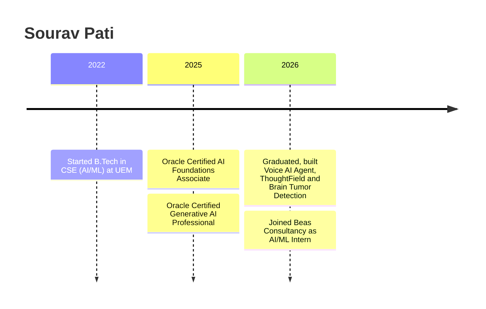
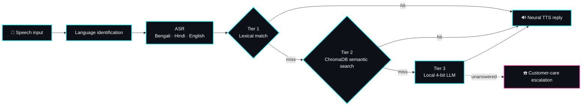
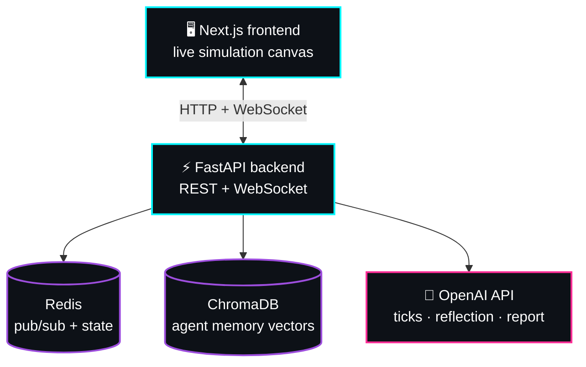
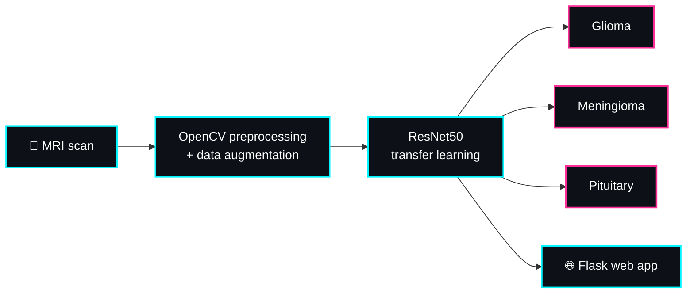

 

## 👨‍💻 About Me

**Computer Science graduate (AI/ML)** building AI applications across **computer vision, speech processing, and NLP**. I like turning models into working products: inference pipelines, APIs, and real-time systems that run on real hardware.

- 🎙️ Building an **offline multilingual voice AI agent** (Bengali, Hindi, English)
- 🧬 Building **ThoughtField**, a multi-agent social simulation engine
- 🏭 Shipping **real-time CV systems** with YOLOv8 and OpenCV at my internship
- 🔬 Contributor to **open-source AI frameworks** (Aden Hive, 8.5k+ ⭐)

## ⚡ Impact at a Glance

| 🎯 **99.3%** | 🔎 **99%** | 🧠 **4 GB → 1.2 GB** | ⚡ **~0.8 s** |
|:---:|:---:|:---:|:---:|
| Brain tumor MRI classification accuracy | Number plate OCR accuracy on test images | LLM memory after 4-bit ONNX quantization | Offline voice agent response time |

## 🗺️ Journey

## 💼 Experience

### 🧪 AI/ML Intern · Beas Consultancy and Services Private Limited
*Aug 2026 – Present*

| | What I built |
|---|---|
| 🎙️ | **Offline multilingual voice AI agent**: speech recognition, language identification, local LLM inference, and text-to-speech |
| 🚚 | **Vehicle number plate recognition**: detects trucks, crops plate regions, extracts text with PaddleOCR at **99% accuracy** on all test images |
| 🏭 | **Real-time factory intrusion detection** on RTSP CCTV streams with YOLOv8 + OpenCV: multi-threaded stream reading, auto-reconnect, IoU-based person tracking, zone-overlap checks for angled cameras |
| 🚨 | **Live zone editor**, dwell-time alarm with siren, and automatic snapshot + event logging (entry time, exit time, duration) to JSON |
| 🏷️ | **Image annotation** and labeled data preparation for an object detection project |

## 🌟 Featured Projects

### 🎙️ Multilingual Voice AI Agent (Offline)
    

A locally running **speech-to-speech agent** supporting **Bengali, Hindi, and English**, combining multilingual speech recognition, language identification, and neural speech synthesis. Runs fully on CPU with ONNX Runtime and was tested offline.

- ⚡ ~**0.8 s** for dataset-matched queries, **2-3 s** for generated answers
- 🧠 Quantized the local LLM to 4-bit ONNX: memory down from ~4 GB to **1.2 GB**

---

### 🧠 ThoughtField
     

An AI-powered **multi-agent social simulation platform** based on the Stanford Generative Agents architecture, where autonomous agents interact and drive prediction-based simulations.

- 🧠 Agent memory and semantic retrieval with **ChromaDB**, real-time workflows with **Redis**
- 📡 REST APIs plus **WebSocket** communication for live agent interactions

---

### 🩻 Brain Tumor Detection
    

An end-to-end deep learning web app that classifies brain MRI scans into **Glioma, Meningioma, and Pituitary** tumors using a fine-tuned **ResNet50** with transfer learning, reaching ~**99.3% accuracy** on the Figshare Brain Tumor MRI dataset.

---

### 🤖 More AI Projects

| Project | What it does | Tech |
|---------|--------------|------|
| 🕸️ [AI Agents: Aden Hive](https://github.com/spati10/-Agents_AdenHive) | Web page summarizer and resume analyzer agents on a self-evolving agent framework | Python, Hive, GraphSpec, LLM |
| 🎯 [SHL Assessment Recommendation Engine](https://github.com/spati10/SHL_Assessment-Recommendation-Engine) | AI-powered system that recommends assessments based on user needs | Python, Streamlit |
| 👤 [Face Identification Model](https://github.com/spati10/face-identification-model) | Attendance tracker using face recognition | Python, Computer Vision, API |

## 🛠️ Tech Stack

#### 🧠 Deep Learning & Computer Vision
      

#### 🎙️ Speech AI
   

#### 💬 LLMs, NLP & RAG
     

#### 🗄️ Data & Vector Databases
   

#### ⚙️ Backend & Integrations
   

## 🎓 Education & Certifications

**B.Tech in Computer Science and Engineering (AI/ML)** · University of Engineering and Management · *2022 – 2026* · CGPA 7.28/10

## 🔬 Open Source

Contributor to the **Aden Hive Framework** (YC-backed, 8.5k+ GitHub stars), working with GraphSpec / NodeSpec multi-agent architecture. Also into content writing.

## 📊 GitHub Activity

 

 

 

